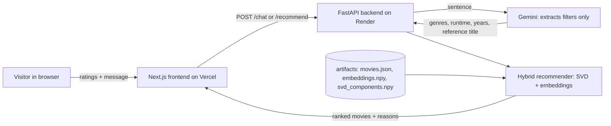

# Conversational Hybrid Movie Recommender

A web app that recommends movies by blending **collaborative filtering** (SVD) with **content similarity** (sentence embeddings), and lets you ask for what you want in plain English ("sci-fi like Interstellar under 2 hours").

**Course:** Python for AI · **Student:** Navaneeth M (Roll No 26, S3 ECE B)

- Live site: https://movie-recommender-eta.vercel.app/
- Backend API: https://movie-recommender-api-w4g5.onrender.com/

> The backend runs on a free tier and sleeps when idle. The first request after a pause can take 30 to 60 seconds.

## How it works



1. **Onboarding:** the visitor rates about five movies. Ratings stay in the browser and are sent with each request. Nothing is stored on the server.
2. **Collaborative score:** ratings are mean-centered, then folded into the saved SVD item factors (30 factors) to predict scores for every movie.
3. **Content score:** a taste profile is the rating-weighted average of the embeddings (`all-MiniLM-L6-v2`) of liked movies (rating 4 or higher), compared to all movies by cosine similarity.
4. **Hybrid:** both scores are min-max normalized per user, then blended:

   ```
   S_final = α · S_content + (1 − α) · S_collab
   α = 1 / (1 + n_ratings / k),   k = 10
   ```

   New users (few ratings) lean on content similarity, and users with more ratings lean on collaborative signals. This addresses the cold-start problem.
5. **Chat:** Gemini receives the sentence and a `set_filters` function declaration, and returns structured filters. The backend validates them with Pydantic and runs the same deterministic pipeline. **The LLM never picks movies itself.** If Gemini is unavailable, a keyword reader extracts genre, runtime and "like X" so the app keeps working.

## Results

Data: MovieLens `ml-latest-small` (610 users, 1,295 movies kept after filtering, 67,847 ratings), with metadata from TMDB. Evaluation uses a random 80/20 split of ratings (54,328 train / 13,519 test).

**Rating prediction (RMSE, lower is better)**

| Model | RMSE |
|---|---|
| Global-mean baseline | 0.9979 |
| SVD (30 factors) | **0.8762** |

**Ranking quality (NDCG@10, higher is better, 591 users)**
Relevance means a held-out rating of 4 or higher.

| Model | NDCG@10 |
|---|---|
| Content only | 0.0447 |
| SVD only | 0.1715 |
| Hybrid, k = 2 | 0.1744 |
| Hybrid, k = 5 | 0.1787 |
| **Hybrid, k = 10** | **0.1813** |
| Hybrid, k = 20 | 0.1774 |
| Hybrid, k = 50 | 0.1553 |

The hybrid with k = 10 beats both single methods, so k = 10 is used in the app. Content-only is weak on its own because plot embeddings capture topic and tone, not whether a viewer liked a film. It is most useful for new users and for "similar to" requests.

## Tech stack

| Layer | Choice |
|---|---|
| Frontend | Next.js (App Router), TypeScript, Tailwind CSS, hosted on Vercel |
| Backend | FastAPI (Python), hosted on Render |
| Collaborative filtering | scikit-learn `TruncatedSVD`, precomputed offline |
| Content embeddings | `sentence-transformers` (`all-MiniLM-L6-v2`), precomputed offline |
| LLM | Google Gemini with function calling (intent extraction only) |
| Data | MovieLens `ml-latest-small` and the TMDB API |
| Storage | Plain files in `backend/artifacts/`, no database |

## Project structure

```
backend/
  train.py          offline data prep, training, evaluation
  app/              FastAPI server, recommender, Gemini layer
  artifacts/        saved model files (committed)
frontend/           Next.js app
README.md
```

## API

| Method | Endpoint | Purpose |
|---|---|---|
| GET | `/health` | Uptime check |
| GET | `/onboarding` | Popular, varied movies to rate |
| POST | `/recommend` | Ratings and optional filters, returns ranked movies |
| POST | `/chat` | Ratings and a message; Gemini extracts filters, then the same pipeline runs |

## Run it locally

Requirements: Python 3.10+, Node.js 18+, a free [TMDB API key](https://www.themoviedb.org/settings/api) (v3) and a free [Gemini API key](https://aistudio.google.com).

**1. Train (once)**
```
cd backend
python -m venv .venv
.venv\Scripts\activate          # Mac/Linux: source .venv/bin/activate
pip install -r requirements-train.txt
```
Create `backend/.env` with `TMDB_API_KEY=...` and `GEMINI_API_KEY=...`, then run:
```
python train.py
```
This downloads MovieLens, fetches TMDB metadata, prints the metrics above, and writes `backend/artifacts/`.

**2. Run the backend**
```
pip install -r requirements.txt
uvicorn app.main:app --reload
```
Interactive API docs are at `http://127.0.0.1:8000/docs`.

**3. Run the frontend** (in a second terminal)
```
cd frontend
npm install
```
Create `frontend/.env.local` with `NEXT_PUBLIC_API_URL=http://127.0.0.1:8000`, then:
```
npm run dev
```
Open `http://localhost:3000`.

## Deployment

- **Backend (Render):** root directory `backend`, build `pip install -r requirements.txt`, start `uvicorn app.main:app --host 0.0.0.0 --port $PORT`. Environment: `GEMINI_API_KEY`, `PYTHON_VERSION=3.11.9`, `ALLOWED_ORIGINS` (the Vercel address).
- **Frontend (Vercel):** root directory `frontend`, environment `NEXT_PUBLIC_API_URL` set to the Render address.

## Limitations and future work

- MovieLens small is a modest dataset, so the results show a working system, not state-of-the-art accuracy.
- Visitors are new users, so collaborative recommendations rely on the few ratings given at onboarding.
- Free hosting tiers have cold starts and rate limits, and the Gemini free tier can be busy (the keyword fallback covers this).
- Future work: user accounts with a database, a larger dataset, and neural collaborative filtering.

## Attribution

This product uses the TMDB API but is not endorsed or certified by TMDB. Ratings data from [MovieLens](https://grouplens.org/datasets/movielens/) (GroupLens Research).